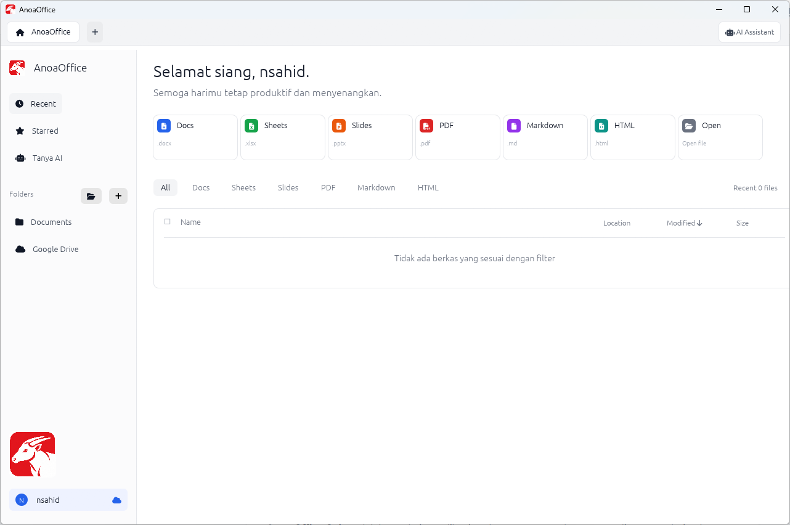
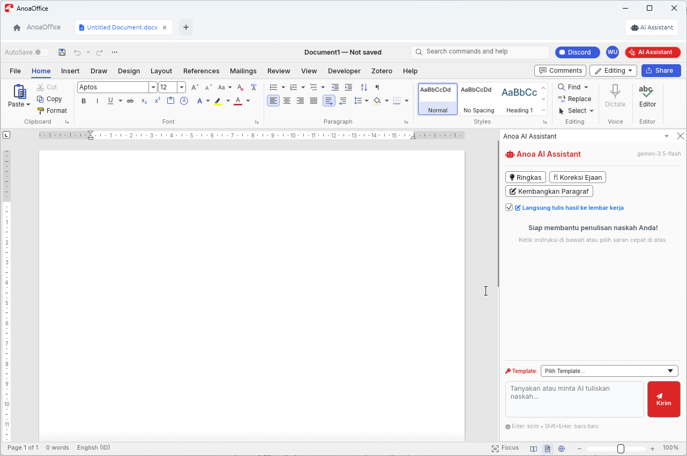
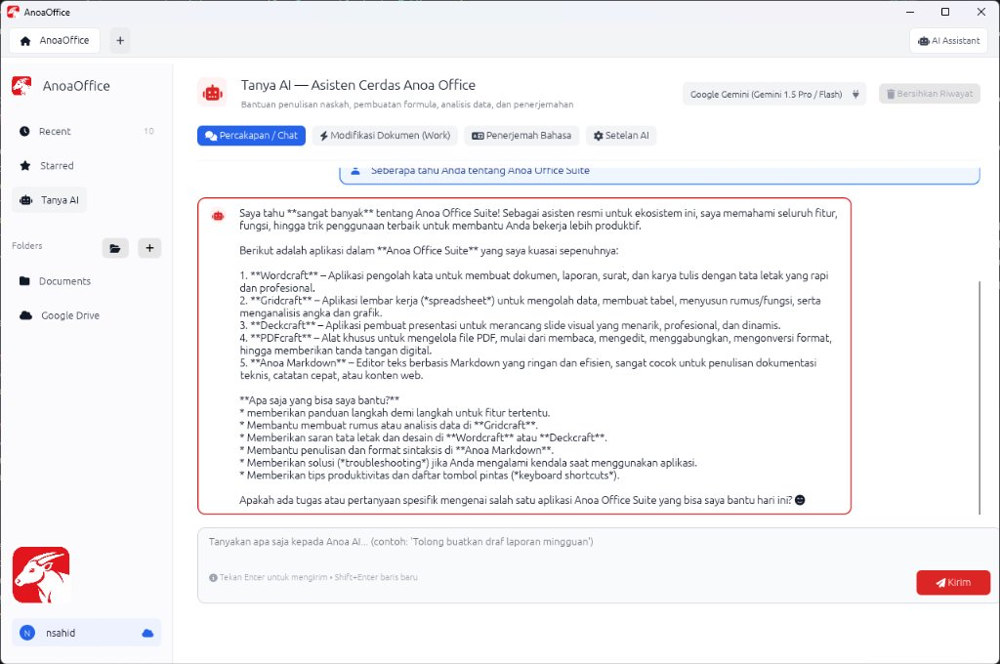

# Anoa Office Suite

<p align="center">
  
</p>

<p align="center">
  <strong>Suite Perkantoran Native Generasi Baru dengan Arsitektur Multi-Tab Modern & Kecerdasan Buatan Terintegrasi</strong>
</p>

<p align="center">
  
  
  
  
  
  <a href="https://nursahid.com/projects/anoa-office-suite"></a>
</p>

---

## 📖 Tentang Anoa Office Suite

**Anoa Office Suite** adalah rangkaian aplikasi perkantoran masa depan yang dirancang dari nol menggunakan bahasa pemrograman **Rust** untuk menghadirkan performa maksimal, konsumsi memori sangat hemat, dan kecepatan peluncuran instan (*zero-lag startup*). Sedangkan untuk Paket Office adalah port dari project ArtCraft yang masih dalam pengembangan. Dengan menambahkan fitur **Markdown** dan **AI Assistant**.

Berbeda dari aplikasi perkantoran konvensional yang membuka puluhan jendela terpisah, Anoa Office Suite mengadopsi **Arsitektur Multi-Tab Terpusat** (*Tabbed Workspace*). Seluruh dokumen Anda—baik naskah artikel, lembar kerja hitungan, presentasi visual, dokumen PDF, maupun catatan Markdown—dapat dikelola dengan rapi di dalam satu jendela kerja utama.

Dilengkapi dengan **Anoa AI Assistant** yang tertanam langsung (*embedded native AI*), Anoa Office Suite bukan hanya sekadar alat pengetikan biasa, melainkan asisten cerdas yang mampu menulis dokumen, menyusun formula spreadsheet otomatis, menganalisis data, dan menyuntikkan hasil kerja langsung ke lembar dokumen aktif Anda.

---

## 📸 Tangkapan Layar (Screenshots)

### 1. Home Dashboard & Manajemen Berkas
Tampilan beranda yang bersih, modern, dan intuitif. Memuat shortcut cepat ke seluruh aplikasi, daftar dokumen terkini (*Recent Files*), dokumen berbintang (*Starred*), serta status sinkronisasi Google Drive Cloud.



---

### 2. Tab Apps & Integrasi Chat AI Berdampingan

Anoa Office Suite menyatukan dokumen anak (seperti Wordcraft dan Gridcraft) ke dalam tab interaktif dengan panel **AI Assistant** yang dapat dibuka tepat di samping lembar kerja:

| **Wordcraft Document Tab + AI Assistant** | **Gridcraft Spreadsheet Tab + AI Assistant** |
|:---:|:---:|
|  |  |
| *Penyusunan naskah & penulisan otomatis dari AI ke lembar dokumen* | *Olah data tabel, rumus spreadsheet, dan kalkulasi otomatis* |

---

### 3. Tanya AI — Fullpage Workspace
Mode layar penuh (*Fullpage Chat*) untuk diskusi panjang, konsultasi strategi, riset ide naskah, atau pembuatan draft lengkap sebelum diekspor ke format dokumen pilihan Anda.



---

## 🚀 Aplikasi & Modul Utama

Anoa Office Suite menghadirkan 5 modul aplikasi utama yang siap menangani seluruh kebutuhan produktivitas:

1. **Wordcraft** (`wordcraft.exe`)
   - Aplikasi pengolah kata profesional untuk membuat surat resmi, artikel, naskah buku, dan laporan berformat `.docx`.
   - Dilengkapi tata letak rapi, ruler presisi, serta dukungan 28 varian keluarga font Aptos.
2. **Gridcraft** (`gridcraft.exe`)
   - Lembar kerja (*spreadsheet*) untuk komputasi angka, perancangan tabel keuangan, rekapitulasi data, serta rumus logika dan matematika berformat `.xlsx`.
   - Terintegrasi langsung dengan konverter tabel Markdown cerdas dari AI Assistant.
3. **Deckcraft** (`deckcraft.exe`)
   - Pembuat presentasi visual interaktif untuk merancang slide bisnis, materi edukasi, dan seminar berformat `.pptx`.
4. **PDFcraft** (`pdfcraft.exe`)
   - Alat serbaguna pengelolaan file PDF: membaca dokumen dengan resolusi tinggi, anotasi, penggabungan beberapa berkas, ekstraksi halaman, hingga verifikasi tanda tangan digital.
5. **Anoa Markdown** (`anoamarkdown.exe`)
   - Editor teks ringan berbasis Markdown dengan fitur *real-time preview*, penulisan formula LaTeX/KaTeX, pemformatan tabel dinamis, dan pengeksporan cepat.

---

## ✨ Fitur Unggulan & Kelebihan

### 🤖 1. Asisten AI Terintegrasi (Zero-Delay Bridge)
- **Komunikasi Antar-Proses Tanpa Jeda**: Hasil generasi AI (seperti draft naskah Word atau tabel spreadsheet) dapat disuntikkan seketika ke lembar kerja aktif cukup dengan satu klik tombol (**Isi ke Word** / **Isi ke Grid**).
- **Format Markdown Manusiawi**: Tampilan balasan chat menggunakan perender Markdown cerdas yang mendukung tabel visual dinamis (*alternating rows*, baris total ber-highlight, dan tombol salin TSV), teks tebal/miring, dan blok kutipan.
- **Penyimpanan Serbaguna**: Salin teks mentah (*Copy*) atau simpan percakapan langsung ke format **DOCX**, **Markdown (.md)**, atau **Teks Biasa (.txt)**.
- **Dukungan Multi-Model**: Terkoneksi otomatis dengan Google Gemini (Gemini 2.5 Flash sebagai default responsif, Gemini Latest, dsb.).

### 🔐 2. Sistem Template Prompt Terenkripsi & Prompt Maker
- **Template Siap Pakai**: Pengguna dapat mengimpor paket template prompt siap pakai untuk mempercepat pembuatan surat resmi, analisa anggaran, atau koding formula.
- **Keamanan Berkas**: Template prompt disimpan dalam format biner terenkripsi khusus (`ANOAPROT`) dengan *XOR keystream dynamic cipher* dan *checksum verification* agar instruksi rahasia/organisasi tidak dapat dibaca bebas.
- **Anoa Prompt Maker (`prompt-maker.exe`)**: Aplikasi mandiri berdesain modern untuk menyusun, mengelompokkan kategori, dan mengenkripsi paket prompt sebelum dibagikan ke pengguna lain.

### ⚡ 3. Performa Native & Stabilitas Tinggi (Rust Powered)
- **Isolasi Proses**: Setiap modul dokumen berjalan di proses Windows Win32 terpisah yang di-*embed* ke dalam tab container host. Jika salah satu dokumen anak mengalami kendala, aplikasi utama dan tab dokumen lainnya tetap aman dan tidak akan *crash*.
- **Zero-Delay Focus Handover**: Perpindahan fokus keyboard dan kursor antara textarea Chat AI dan lembar dokumen berlangsung instan tanpa *stutter* atau *message-queue deadlock*.
- **Hemat Sumber Daya**: Dibangun tanpa runtime web/browser (bukan Electron), menjamin penggunaan RAM yang sangat rendah dan baterai laptop yang lebih hemat.

### ☁️ 4. Google Drive Cloud Engine Nyata
- Terintegrasi langsung dengan Google Accounts Discovery dan Google Drive REST API resmi.
- Sinkronisasi dokumen aktif langsung ke direktori penyimpanan cloud pengguna.

### 🔤 5. Tipografi & Ikon Vektor Lengkap (Offline Ready)
- Seluruh 28 varian font keluarga Aptos diintegrasikan dan di-embed ke dalam biner.
- Antarmuka 100% menggunakan ikon vektor offline **Font Awesome** (`fa-solid` & `fa-regular`), menghasilkan tampilan yang tajam di layar HiDPI dan bebas dari emoji kartun bawaan OS.

---

## 🛠️ Arsitektur Proyek

Struktur direktori kerja repositori Anoa Office Suite:

```text
AnoaOfficeSuite/
├── apps/
│   ├── anoa-office/       # Aplikasi host utama (tab manager, sidebar, dock AI, dashboard)
│   └── prompt-maker/      # Aplikasi pembuat & pengenkripsi template prompt AI
├── crates/
│   ├── anoa-ai/           # Engine AI (Gemini HTTP client, context memory, streaming)
│   ├── anoa-core/         # Utilitas berkas, enkripsi prompt (ANOAPROT), recent items
│   ├── anoa-markdown/     # Parser & engine konversi Markdown
│   └── anoa-ui/           # Desain sistem, tema warna, ikon FA, perender tabel Markdown
├── sources-code/
│   ├── wordcraft/         # Source code biner Wordcraft (.docx editor)
│   ├── gridcraft/         # Source code biner Gridcraft (.xlsx spreadsheet)
│   ├── deckcraft/         # Source code biner Deckcraft (.pptx presentation)
│   ├── pdfcraft/          # Source code biner PDFcraft (PDF reader & tool)
│   └── markdown/          # Source code biner Anoa Markdown
├── assets/                # Logo, ikon, font Aptos, dan Font Awesome TTF
├── docs/images/           # Tangkapan layar untuk dokumentasi
└── bin/                   # Folder biner siap pakai (.exe)
```

---

## 📦 Kompilasi & Menjalankan Aplikasi

### Prasyarat
- Sistem Operasi: **Windows 10 / 11 (64-bit)**
- **Rust Toolchain**: `stable-x86_64-pc-windows-gnu` atau `stable-x86_64-pc-windows-msvc`
- PowerShell 5.1 / PowerShell 7+

### Membangun dari Sumber (Build Release)

1. Clone repositori:
   ```powershell
   git clone https://github.com/nursahid/AnoaOfficeSuite.git
   cd AnoaOfficeSuite
   ```

2. Jalankan skrip pembangunan rilis:
   ```powershell
   powershell -ExecutionPolicy Bypass -File .\build_release.ps1
   ```

3. Biner yang telah dikompilasi akan berada di folder `bin/`:
   - `bin/anoa-office.exe` (Aplikasi Utama)
   - `bin/wordcraft.exe`
   - `bin/gridcraft.exe`
   - `bin/deckcraft.exe`
   - `bin/pdfcraft.exe`
   - `bin/anoamarkdown.exe`
   - `bin/prompt-maker.exe`

---

## 💖 Dukung Pengembangan & Donasi

Anoa Office Suite dikembangkan dengan dedikasi tinggi untuk menghadirkan alternatif aplikasi perkantoran yang cepat, independen, modern, dan bebas beban bagi seluruh pengguna.

Jika proyek ini bermanfaat bagi produktivitas kerja Anda atau institusi Anda, Anda dapat memberikan apresiasi dan mendukung keberlanjutan pengembangan melalui:

👉 **[Dukung Proyek Anoa Office Suite di nursahid.com](https://nursahid.com/projects/anoa-office-suite)**

Setiap bentuk dukungan, masukan, dan donasi sangat berarti bagi penyempurnaan fitur dan ekosistem Anoa Office Suite ke depan. Terima kasih!

---

## 📄 Lisensi

Hak Cipta © 2026 **Nur Sahid** & Tim Pengembang Anoa Office Suite. Seluruh hak cipta dilindungi undang-undang.

